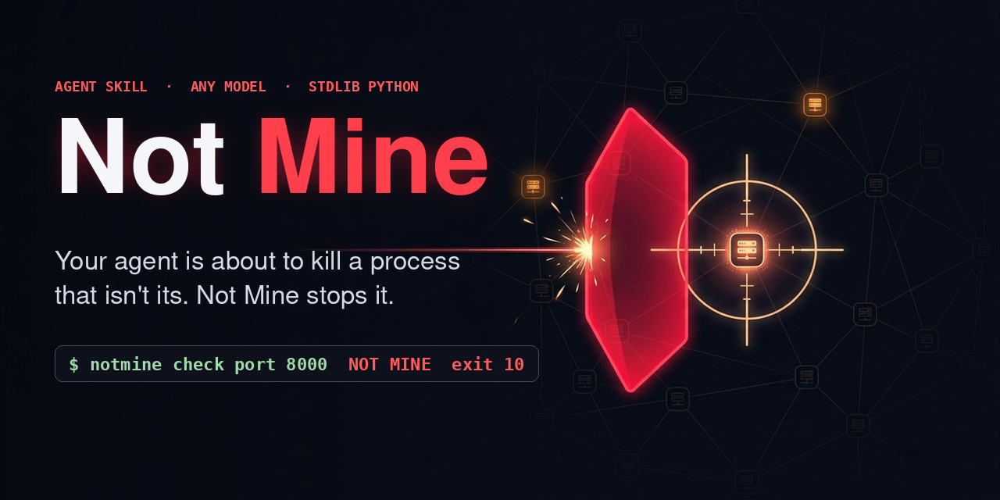

<p align="center">
  
</p>

<p align="center"><b>Before your coding agent kills, deletes, deploys, migrates, drops or force-pushes anything, Not Mine proves the target belongs to the current task. If it can't, the agent stops and asks you.</b></p>

<p align="center">
  <a href="https://github.com/Maftuuh1922/not-mine/actions/workflows/ci.yml"></a>
  <a href="LICENSE"></a>
  
  
</p>

<p align="center">
  
  <br><sub>A real session, recorded by <a href="tools/make_demo_svg.py"><code>tools/make_demo_svg.py</code></a>. Only cosmetic edits: the sandbox path is shown as <code>~/demo</code> and long evidence lists are trimmed.</sub>
</p>

`not-mine` is an [Agent Skill](https://agentskills.io) (`SKILL.md`) plus a one-file,
standard-library-only Python CLI, `notmine`. It works with any agent that can run a shell
command, on any model: Claude Code, Codex, Gemini CLI, Cursor, opencode, Neovarch Agent,
Aider, or you in a terminal.

## Proof

### The incidents it is built for

Public reports in the Claude Code issue tracker, each opened and read for this README.
They are user reports, not vendor postmortems; dates are when the issue was filed. The
pattern is about how agents act on shared machines, not about one model or vendor.

| filed | report | what happened (quoted or summarized from the issue) |
|---|---|---|
| 2026-04-20 | [anthropics/claude-code#50971](https://github.com/anthropics/claude-code/issues/50971) | Translated from Spanish: *"Killed a production process on port 8000, assumed it was its backend without checking. It was a different production application. Caused a $1000 loss."* |
| 2026-08-27 | [#90070](https://github.com/anthropics/claude-code/issues/90070) | *"the model ran `pkill -f "next-server"` — a machine-wide pattern kill intended to stop only its own server. It matched any Next.js server on the host."* A sibling project's dev server was killed. |
| 2026-08-23 | [#89014](https://github.com/anthropics/claude-code/issues/89014) | The agent hand-ran `lftp mirror --reverse --delete` against a live host: *"That directory held customer photo uploads. FTP has no undelete."* |
| 2026-04-11 | [#46650](https://github.com/anthropics/claude-code/issues/46650) | *"the AI tries to kill my production instance everytime, it also tried to delete my production data and succeeded"* |
| 2026-05-06 | [#56506](https://github.com/anthropics/claude-code/issues/56506) | Title: *"Claude Code caused server outage by unauthorized SSH login and destructive PM2 commands"* |
| 2026-06-29 | [#72274](https://github.com/anthropics/claude-code/issues/72274) | Title: *"Cross-session credential leakage: production database modified on unauthorized host"* |
| 2025-07-06 | [#3068](https://github.com/anthropics/claude-code/issues/3068) | *"Claude Code terminates its own process AND Visual Studio Code when attempting to kill Node.js servers using broad process termination commands like `pkill -f node`."* |
| 2025-10-20, 2025-12-14 | [#9970](https://github.com/anthropics/claude-code/issues/9970), [#13941](https://github.com/anthropics/claude-code/issues/13941) | Titles: the agent *"terminates itself when asked to kill Node.js processes"*; *"crashes its own session when using broad process killers (taskkill //IM node.exe, pkill node)"* |
| 2025-07-01 | [#2782](https://github.com/anthropics/claude-code/issues/2782) | Title: the agent *"creates and executes the command "killall node" to kill all node-related services running on the server"* |
| 2025-08-04 | [#5070](https://github.com/anthropics/claude-code/issues/5070) | Title: *"Claude Code killing other Claude Code sessions without authorization"* |

Every one of these starts with the agent *assuming* a target was its own. `notmine` makes
that assumption a check with evidence and an exit code.

### Tests and CI

[](https://github.com/Maftuuh1922/not-mine/actions/workflows/ci.yml)
Every push runs the unit and end-to-end tests and the benchmark below on **Ubuntu and
macOS**, Python 3.10 and 3.13. Each run publishes the benchmark table in its job summary
and uploads `results.json` as an artifact. Click the badge for the latest runs.

### Benchmark: the decoy range

A throwaway sandbox with fake "production" targets next to the agent's own, and a known
right answer for each. 55 core cases plus 4 known-hard cases reported separately.

| metric | Linux, Python 3.12 |
|---|---|
| correct verdict | **55/55** |
| decoys judged `MINE` (would have been acted on) | **0/36** |
| agent's own targets blocked (needless question) | **0/19** |
| exit code matches verdict | 55/55 |
| median time per check | 75 ms |
| known-hard cases | **3/4 judged `MINE` wrongly**, 1/4 asked; see [Limitations](#limitations) |

Raw results: [`bench/results-linux.json`](bench/results-linux.json) (machine-readable) and
[`bench/RESULTS-linux.md`](bench/RESULTS-linux.md) (every case). Reproduce:

```bash
git clone https://github.com/Maftuuh1922/not-mine && cd not-mine
python3 bench/run_bench.py --json results.json --markdown results.md
```

**Read the 100% honestly.** The cases were written by the same author as the rules, so it
shows the rules do what they claim, not that they generalize. The known-hard set shows
where they don't. New decoys from real incidents are the most useful contribution.

## Install in 30 seconds

```bash
# any agent that reads ~/.agents/skills (Codex, Gemini CLI, Cursor, opencode):
git clone https://github.com/Maftuuh1922/not-mine ~/.agents/skills/not-mine
# Claude Code:
git clone https://github.com/Maftuuh1922/not-mine ~/.claude/skills/not-mine
```

Then tell your agent once: *"Use the not-mine skill: start a session now and check every
target before you kill, delete, deploy, migrate or force-push."* Needs Python 3.8+, nothing else.
Per-agent paths and other options are under [Install (details)](#install-details).

## What it checks

| kind | command | evidence used |
|---|---|---|
| process | `notmine check pid 1234` | running, uid, ancestor of the agent (self-kill), existed at session start, start time vs session start, descendant of the agent root, cwd inside workspace, registered (start time pinned against PID reuse) |
| port | `notmine check port 3000` | every listener's pid through the process check; who held the port at session start |
| path | `notmine check path ./dist` | real path after symlinks and `..`; inside workspace; workspace root, `$HOME`, `/`, `.git`; `protected_paths`; temp files created during the session |
| database | `notmine check db DATABASE_URL` | URL or env var name, password redacted; prod tokens in host / db name / user; local host, unix socket, SQLite in workspace; allow/deny lists |
| Kubernetes | `notmine check kube current -n shop` | kubeconfig parsed without kubectl: context, cluster, API server, namespace; local clusters (kind, minikube, k3d, docker-desktop, localhost); system namespaces |
| AWS | `notmine check aws current [--live]` | profile, role ARN / SSO account from `~/.aws/config`; optional `sts get-caller-identity`; LocalStack-style local endpoint |
| GCP | `notmine check gcp current` | project from env or active gcloud configuration |
| git | `notmine check git origin/feature-x` | protected branch patterns; commits by other authors a force-push would delete; branch created during the session (reflog) |
| docker | `notmine check docker web-1` | name, image, labels, created time, compose working dir; remote `DOCKER_HOST` |

Verdicts and exit codes:

| exit | verdict | meaning |
|---|---|---|
| 0 | `MINE` | evidence ties it to this task: proceed |
| 10 | `NOT_MINE` | evidence ties it to something else: stop and ask the user |
| 11 | `UNKNOWN` | not enough evidence: stop and ask the user |
| 2 | — | usage error |

Plus a safe kill that refuses anything not `MINE` and re-verifies right before the signal:

```bash
notmine kill :3000          # by port
notmine kill 4242 --dry-run
```

## Quick start

```bash
cd my-project
notmine begin                     # record session start, workspace, existing processes
npm run dev &                     # anything you start in the workspace from now on is yours
notmine check port 3000           # MINE -> ok to restart
notmine check db DATABASE_URL     # before a migration or reset
notmine check git origin/main     # before a force-push -> NOT_MINE (protected branch)
notmine end
```

`notmine register pid|port|path|git|docker <target>` marks something you created outside
the workspace as yours. `notmine status` shows the active session.

Session state lives in `~/.local/state/notmine/sessions/` (override with `NOTMINE_HOME`),
never in your repository. Commands run from any subdirectory of the workspace find it.

## Install (details)

The CLI is one file, `scripts/notmine.py`. It needs Python 3.8+ and nothing else.

**As a skill** (clone the repo into your agent's skills directory; the folder must be named `not-mine` to match the skill name, so give it explicitly when cloning):

| agent | user-level | project-level |
|---|---|---|
| Claude Code | `~/.claude/skills/not-mine` | `.claude/skills/not-mine` |
| Codex | `~/.agents/skills/not-mine` | `.agents/skills/not-mine` |
| Gemini CLI | `~/.gemini/skills/not-mine` or `~/.agents/skills/not-mine` | `.gemini/skills/not-mine` or `.agents/skills/not-mine` |
| Cursor | `~/.cursor/skills/not-mine` or `~/.agents/skills/not-mine` | `.cursor/skills/not-mine` or `.agents/skills/not-mine` |
| opencode | `~/.config/opencode/skills/not-mine` (also reads `~/.claude/skills`, `~/.agents/skills`) | `.opencode/skills/not-mine` |

```bash
git clone https://github.com/Maftuuh1922/not-mine ~/.agents/skills/not-mine
```

Directory locations are from each tool's docs as of October 2026
([Claude Code](https://code.claude.com/docs/en/skills), [Codex](https://developers.openai.com/codex/skills), [Gemini CLI](https://geminicli.com/docs/cli/skills),
[Cursor](https://cursor.com/docs/skills), [opencode](https://opencode.ai/docs/skills/)). If your
agent is not listed or has no skills support (Neovarch Agent, Aider, a custom harness):
put the clone anywhere and add one line to `AGENTS.md` / your system prompt:
*"Before any kill, delete, deploy, migrate, drop or force-push, follow `/path/to/not-mine/SKILL.md`."*

**As a command** (optional, puts `notmine` on your PATH):

```bash
pipx install git+https://github.com/Maftuuh1922/not-mine
# or: python3 -m pip install --user git+https://github.com/Maftuuh1922/not-mine
```

## Configuration

Optional `.notmine.json` in the workspace and/or `~/.config/notmine/config.json`.
See [`.notmine.example.json`](.notmine.example.json) and the Configuration section of
[`SKILL.md`](SKILL.md). Precedence: `deny` > `allow` > production patterns > local
detection > shared patterns > `UNKNOWN`.

Default production tokens are `prod`, `production`, `prd`, `live`, matched as whole
tokens (`prod-db`, `db_prod`, `app.prod.internal` match; `product`, `preprod` do not).

## Benchmark details

`bench/run_bench.py` builds a throwaway sandbox and checks 55 targets with known
answers, then 4 "known-hard" cases reported separately:

- **Decoys:** a fake production HTTP server started before the session on port 8000
  (or the next free port), a sibling project's dev server on 3000, a pre-existing
  process inside the workspace, the agent's own process (self-kill), pid 1,
  `~/.ssh`, a symlink in the workspace pointing to `~/.ssh`, `..` escapes, `/etc`,
  prod-named database URLs, a kubeconfig whose current context is `prod-eu`, a GKE
  prod cluster, a prod AWS profile, a denied AWS account, an active `acme-prod` gcloud
  project, force-pushing `main`, a branch where a teammate's commit would be lost,
  containers labelled production or created before the session.
- **Own targets:** the agent's dev server, its port and a worker started in the
  workspace, a registered process, workspace files, temp dirs created during the
  session, local Postgres/Redis/SQLite, kind/minikube, LocalStack, allowlisted
  accounts, a branch created during the session, the workspace's compose container.

Processes are real; kube/AWS/GCP configs are fake files; Docker is a shim that answers
`docker inspect` from JSON (so the bench needs no Docker engine); databases are URLs only.

Run the tests too: `python3 -m unittest discover -s tests -v`.

## Limitations

- **The user's own processes.** A process the user starts in the workspace from another
  terminal during your session has the same uid, cwd and time window as yours. It comes
  back `MINE` (known-hard case 1).
- **Tunnels and innocent names.** `localhost:15432` can be an SSH tunnel to production;
  `acme-main` can be the production cluster. Name and host checks cannot see that
  (cases 2 and 3). Use `deny` / `allow` in config for the targets you know.
- **Data inside the workspace.** Everything inside the workspace is `MINE` unless listed
  in `protected_paths` (case 4, the shape of #89014). Deploy directories with user data
  need that list.
- **It is a check, not an enforcement layer.** The agent has to run it. It complements
  command guards such as
  [destructive_command_guard](https://github.com/Dicklesworthstone/destructive_command_guard) and
  [cc-safety-net](https://github.com/kenryu42/cc-safety-net), which block known-dangerous
  command patterns but do not ask whose target it is. You can call `notmine check` from
  a PreToolUse-style hook if your agent has one.
- **Platform.** Linux (via `/proc`) and macOS (via `ps` and `lsof`). No Windows support;
  WSL works as Linux. On macOS, process start times have 1-second resolution, so a
  process started within a second of `notmine begin` may be misjudged; the pre-existing
  process snapshot covers most of those.
- **Remote resources are mostly `UNKNOWN`.** That is deliberate: without an allowlist
  there is no evidence a remote database, cluster or account is a dev copy.
- **Auto-detected agent root.** If the detected root is an IDE (for example Cursor), every
  process started from its terminals after `begin` counts as yours. Pass `--root-pid` or
  `--no-auto-root` if that is too broad.
- **kubeconfig parsing** handles the standard layout kubectl writes, not arbitrary YAML.

## Related work

Projects in the same area that `notmine` learned from, each solving a part of it:
[owayo/safe-kill](https://github.com/owayo/safe-kill) (process ancestry check before kill),
[mukes555/PortNanny](https://github.com/mukes555/PortNanny) (macOS app showing port owners),
[roboticforce/agent-guardrails](https://github.com/roboticforce/agent-guardrails) (blocks
risky terraform/db/k8s command patterns via hooks), and the command guards linked above.
`notmine` focuses on one question across processes, files and infrastructure:
*is this target part of the current task?*

## Bahasa Indonesia (ringkas)

**Not Mine** adalah agent skill (`SKILL.md`) + CLI Python tanpa dependensi (`notmine`)
yang memastikan target sebuah aksi memang milik tugas yang sedang dikerjakan, **sebelum**
agen melakukan kill, hapus file, deploy, migrasi, drop database, atau force-push.

- `notmine begin` di awal sesi: mencatat waktu mulai, folder kerja, dan semua proses yang
  sudah berjalan.
- `notmine check <jenis> <target>`: hasilnya `MINE` (exit 0, boleh lanjut), `NOT_MINE`
  (exit 10) atau `UNKNOWN` (exit 11). Dua yang terakhir artinya **berhenti dan tanya
  pengguna**, sambil menunjukkan buktinya.
- Jenis yang dicek: proses/PID, port, path file, URL database, konteks Kubernetes,
  profil AWS, project GCP, branch git, container docker.
- `notmine kill :3000` hanya mematikan proses yang terbukti milik sesi ini. Jangan pakai
  `pkill -f` atau `killall`.

Instalasi: clone repo ini ke folder skill agen Anda (misalnya `~/.claude/skills/not-mine`
atau `~/.agents/skills/not-mine`). Untuk agen tanpa dukungan skill, rujuk `SKILL.md`
dari `AGENTS.md`. Batasannya ditulis jujur di bagian *Limitations* di atas, termasuk kasus
yang masih lolos (proses milik pengguna di folder kerja, tunnel SSH ke produksi, dan data
pelanggan di dalam folder deploy).

## License

MIT
